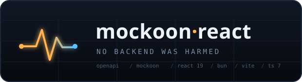
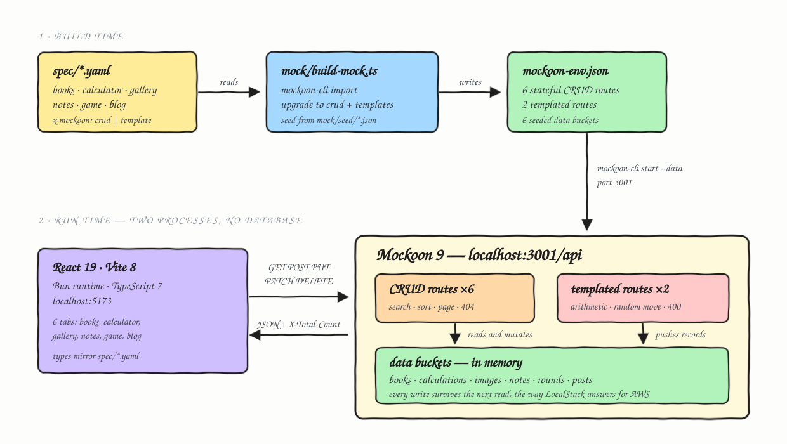
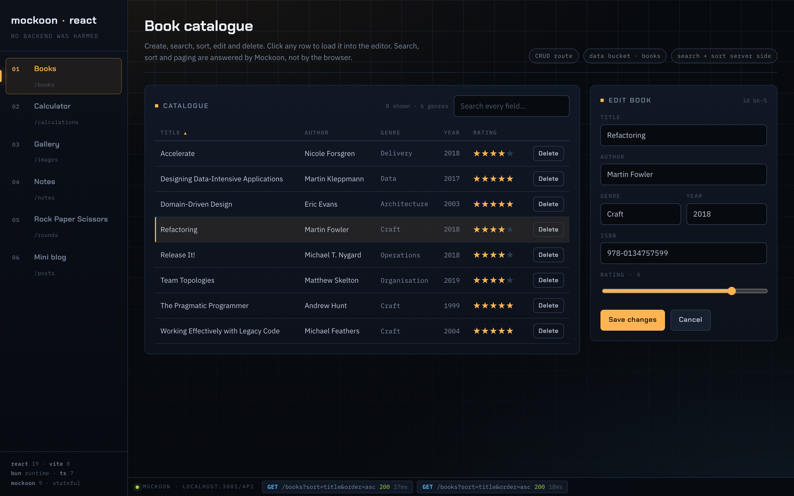
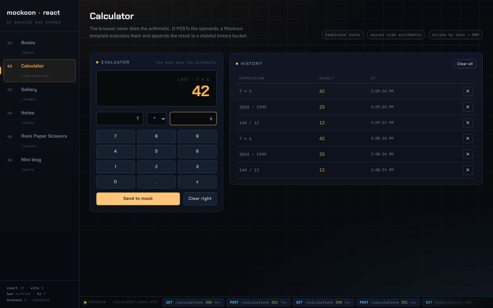
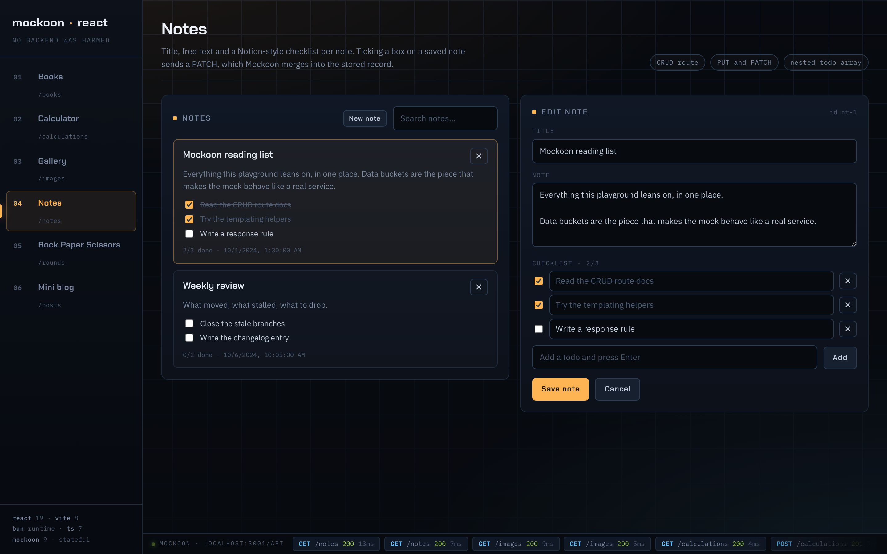
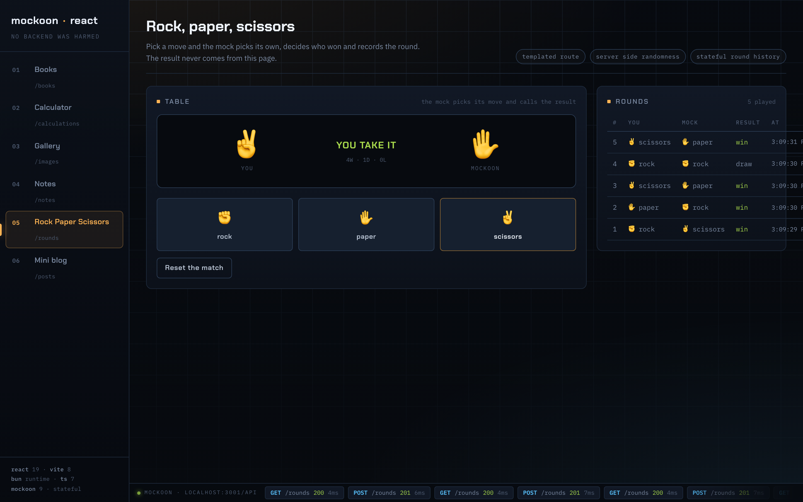
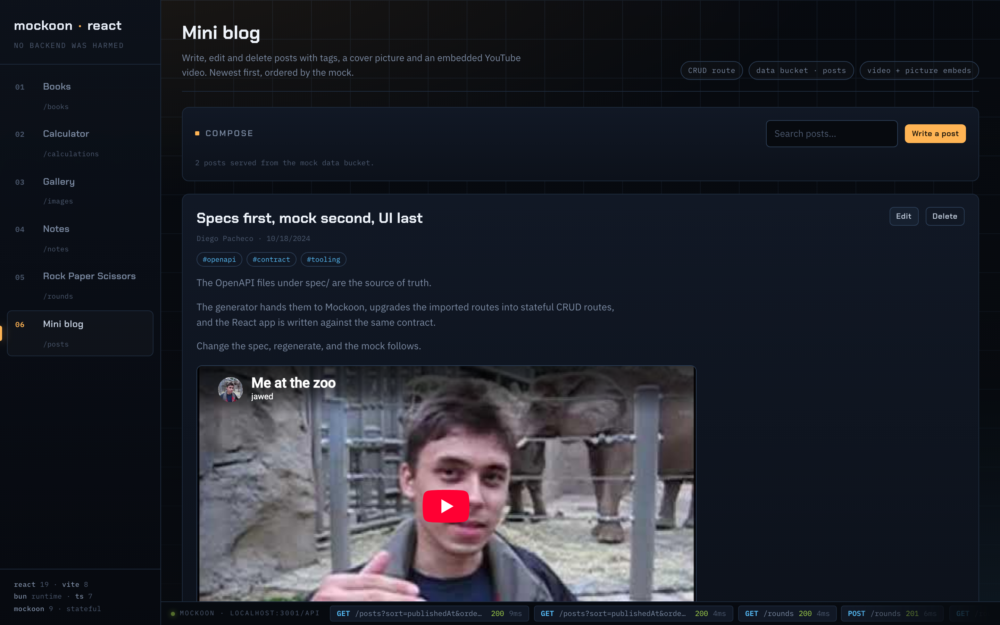

A six-tab React 19 application whose backend does not exist. Every endpoint the app calls is served by [Mockoon](https://github.com/mockoon/mockoon), generated from OpenAPI specs, and it is **stateful** — create a book in one request and the next list call returns it, the way LocalStack answers for AWS. There is no server code, no database, and no persistence layer anywhere in this repository.

## How it Works?

The `spec/` folder holds six OpenAPI 3 documents and is the only source of truth. Each path carries an `x-mockoon` vendor extension saying how the mock should realise it: `crud: <bucket>` for a stateful CRUD resource, or `template: <name>` for a route the mock computes itself.

`mock/build-mock.ts` hands every spec to `mockoon-cli import`, then upgrades the imported static routes — collapsing `/books` and `/books/{id}` into a single Mockoon CRUD route bound to a data bucket, and filling templated routes with Handlebars bodies. It seeds the buckets from `mock/seed/*.json` and writes one `mock/mockoon-env.json`, which `mockoon-cli validate` checks.

At run time two processes exist: Mockoon on `:3001` and Vite on `:5173`. Mockoon keeps its six data buckets in memory, so writes survive across requests until the process restarts.

## Architecture



Two of the routes are not simple storage. The calculator's `POST /calculations` evaluates the expression **inside the mock** with Mockoon's `add` / `subtract` / `multiply` / `divide` / `modulo` helpers and pushes the record onto the history bucket with `setData 'push'`. The game's `POST /rounds` picks the computer move with `oneOf`, decides the winner with a `switch` over `playerMove|computerMove`, and appends the round. The browser never computes either result.

## Features

- **Stateful mock, not a stub** — Mockoon CRUD routes read and write real data buckets, so create, update and delete are all visible on the next read.
- **Specs drive the mock** — add a path with `x-mockoon: { crud: things }` plus a seed file and the route exists after a regenerate; nothing is hand-written twice.
- **Server-side arithmetic and randomness** — the calculator and the game are decided by the mock, proving a templated route can do more than replay a fixture.
- **Server-side search, sort and paging** — the books grid passes `search`, `sort` and `order` to Mockoon and reads `X-Total-Count` back; the browser does no filtering.
- **Live request log** — a strip along the bottom shows every call as it happens with method, path, status and latency, so the mock traffic is never hidden.
- **Real error paths** — dividing by zero returns `400 division_by_zero` and an unknown move returns `400 invalid_move`, both from Mockoon response rules rather than client-side guards.
- **Generator fails loud** — a spec operation with no `x-mockoon` directive aborts the build instead of silently serving an empty body.

## Stack

- **Mockoon 9** — the whole backend; its CRUD routes plus data buckets are what make the mock stateful instead of static.
- **React 19** — the UI, with no state library because six independent tabs never share state.
- **Vite 8** — dev server and bundler, fast enough that the mock is the slow part.
- **Bun 1.4** — package manager, script runtime and the generator's runtime; its native `Bun.YAML` parses the specs with zero dependencies.
- **TypeScript 7** — the Go-native compiler, used for typechecking only since Vite handles the transpile.
- **Zero runtime dependencies** — `react` and `react-dom` are the only two; styling, HTTP, image downscaling and YouTube parsing are all hand-written.

## Contracts / APIs

Six OpenAPI 3 documents in `spec/`, all served under `http://localhost:3001/api`.

| Spec | Resource | Kind | Endpoints |
| --- | --- | --- | --- |
| `books.yaml` | `/books` | CRUD | `GET` (search, sort, order, page, limit) · `POST` · `GET/PUT/DELETE /{id}` |
| `calculator.yaml` | `/calculations` | CRUD + template | `POST` evaluates · `GET` history · `PUT` replaces · `DELETE /{id}` |
| `gallery.yaml` | `/images` | CRUD | `GET` · `POST` · `GET/DELETE /{id}` |
| `notes.yaml` | `/notes` | CRUD | `GET` · `POST` · `GET/PUT/PATCH/DELETE /{id}` |
| `game.yaml` | `/rounds` | CRUD + template | `POST` plays a round · `GET` history · `PUT` resets |
| `blog.yaml` | `/posts` | CRUD | `GET` (search, sort, order) · `POST` · `GET/PUT/DELETE /{id}` |

Mockoon's CRUD routes answer `search`, `sort`, `order`, `page` and `limit` on the list endpoint and set `X-Total-Count` and `X-Filtered-Count`. `POST` assigns an `id` when the body omits one. `PUT /{resource}` with `[]` clears a whole bucket, which is how the calculator and game reset their history.

```bash
curl -s http://localhost:3001/api/books?search=kleppmann
curl -s -X POST http://localhost:3001/api/calculations \
  -H 'Content-Type: application/json' -d '{"a":6,"op":"*","b":7}'
curl -s -X POST http://localhost:3001/api/rounds \
  -H 'Content-Type: application/json' -d '{"move":"rock"}'
```

## Key data structures and design decisions

**`x-mockoon` as the bridge.** OpenAPI has no way to say "this resource is stateful". The vendor extension carries that intent in the spec, so the generator never needs a second config file listing which paths are CRUD.

**Deterministic UUIDs.** Every route, response and bucket UUID is a SHA-1 of a stable seed string, so regenerating the environment produces a byte-identical file. Random UUIDs would make every regenerate a diff.

**Templated routes are ordered before CRUD routes.** Mockoon matches routes in `rootChildren` order and stops at the first hit. `POST /calculations` therefore reaches the evaluating template rather than the CRUD create, while `GET /calculations` falls through to CRUD.

**`bodyRaw` not `body` inside templates.** `body` returns a Handlebars `SafeString`, which `setData` would store as `{"string":"rock"}`. `bodyRaw` returns the plain value, keeping numbers numeric in the bucket.

**Images are data URLs, not files.** The original ask was a filesystem temp directory, but a Mockoon mock has no disk to write to and adding a real file server would mean adding a real backend. Dropped files are downscaled to 1280px and re-encoded until they fit under 3.5 MB, then stored in the bucket as a data URL. Images added from a URL keep their URL. This is the one place the mock cannot behave exactly like a real service, and it is deliberate.

**A generic `resource<TItem, TDraft>()` factory.** All six clients are the same six calls over a different path, so `src/api/resource.ts` builds them and only the calculator and game add their own POST.

**Types mirror the specs by hand.** `src/types/api.ts` matches `spec/*.yaml` one to one. Generating them would mean adding an OpenAPI codegen dependency for six small files.

## How to run

```bash
./scripts/start.sh
```

Generates the mock, starts Mockoon on `:3001`, starts Vite on `:5173` and returns. Open http://localhost:5173.

```bash
./scripts/stop.sh     # stops both processes
./scripts/build.sh    # generate mock, typecheck, build web/dist
./scripts/test.sh     # generate, typecheck, 39 API checks against a live mock, build
```

Logs land in `.run/`. Ports are overridable with `MOCK_PORT` and `WEB_PORT`.

`./scripts/test.sh` boots a real Mockoon instance and exercises every endpoint, including the stateful paths — that create is visible in the next list, that the mock computes `9 / 2 = 4.5`, that division by zero is a 400, that the outcome of every round matches the two moves, and that a 200 KB data URL survives a round trip.

```
39/39 checks passed
```

## Printscreens

### 1 · Books — CRUD with a grid



The catalogue on the left is the response to `GET /books?sort=title&order=asc`. Clicking a row loads it into the editor on the right, which then does `PUT /books/{id}`; the selected row is marked with an amber bar. Typing in the search box re-requests with `?search=`, so filtering happens in Mockoon. Clicking a column header flips `sort` and `order`. The pills under the title name the Mockoon features in play, and the strip along the bottom shows the four requests this screen made, each under 20 ms.

### 2 · Calculator — the mock does the arithmetic



`144 / 12`, `2024 - 1999` and `7 * 6` were each sent to `POST /calculations`. The large amber figure is the mock's answer, not the browser's — the page only posts the operands. Each accepted calculation is appended to the `calculations` bucket, which is what the history table on the right lists. The request log shows the `POST /calculations 201` followed by the `GET /calculations 200` that refreshes the history.

### 3 · Gallery — drag and drop or a URL


The dashed target accepts files dropped from the machine; they are downscaled in a canvas and posted as data URLs. The panel on the right adds an image by URL instead, which stores just the link. The four seeded images below are remote URLs. Every tile shows its source and stored size, the `✕` sends `DELETE /images/{id}`, and clicking a tile opens a full-size overlay.

### 4 · Notes — text plus a Notion-style checklist



Each note carries a title, free text and a nested `todos` array. Ticking a box on a saved note in the left column sends a `PATCH /notes/{id}` with only the changed array, which Mockoon merges into the stored record — the title and body are untouched. The editor on the right builds the checklist locally and saves the whole note with `PUT`. The footer of each card counts the completed todos.

### 5 · Rock, paper, scissors — the mock decides



Pressing a move sends `POST /rounds { move }` and nothing else. Mockoon picks its own move with `oneOf`, resolves the winner in a `switch`, stamps the round and pushes it onto the `rounds` bucket. The verdict in the centre and the running `W · D · L` tally both come back from the server. The table on the right is `GET /rounds`, oldest at the bottom, and the request log alternates `POST 201` and `GET 200`.

### 6 · Mini blog — posts with pictures and video



Posts are listed newest first because the request is `GET /posts?sort=publishedAt&order=desc`. A post can carry tags, a cover picture — a URL or an uploaded data URL — and a YouTube link in any format, which is parsed to an id and embedded. `Write a post` opens the composer in the top panel for both creating and editing; `Delete` sends `DELETE /posts/{id}`.
