<p align="center">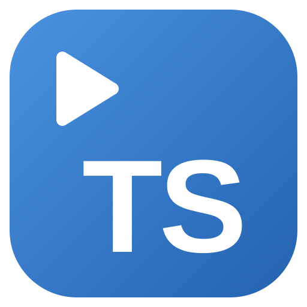</p>

# TypeScript Playground

A local admin UI to write, type check and run TypeScript, with line numbers, syntax highlighting and auto-complete. It also has markdown docs and runnable samples for the core TypeScript features: types and inference, narrowing, generics, utility types, the event loop, promises, async/await, promise combinators, async iterators, cancellation and error handling. It runs as a web app, on a phone-sized screen, and as a macOS Electron app.

## How it Works

1. One Bun server serves the JSON API and the built React UI on `127.0.0.1`.
2. When you press Run, the code goes to `POST /api/run`. The server writes `main.ts` and a strict `tsconfig.json` to a fresh temp dir, type checks with TypeScript 7 (`tsc`), and only then runs it with `bun main.ts`. A 10s timeout and a 64KB output cap apply to both steps.
3. Auto-complete calls `GET /api/complete`. At startup, the server reads the real globals of the Bun runtime (`Promise`, `Math`, `console`, ...) and the prototypes of `Array`, `String`, `Map` and friends, so suggestions match the runtime that runs your code.
4. The editor is a transparent textarea over a highlighted `<pre>`, with a line number gutter. Native copy, paste, cut and undo keep working.
5. Docs are markdown rendered to HTML by a small renderer on the server. Every `ts` code block gets a "Run in Playground" button.
6. The Electron app runs `scripts/start-all.sh` on launch, shows a boot screen with every service, and runs `scripts/stop-all.sh` on quit.

## Architecture

<p align="center">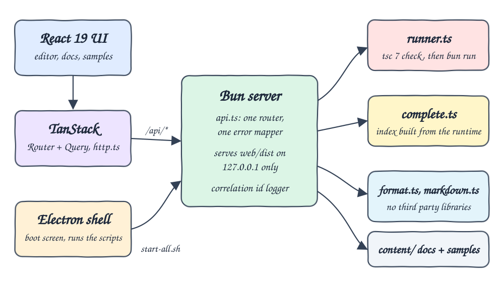</p>

## Features

- **Type check and run**: real `tsc` with `strict`, then `bun`, with stdout, stderr, the real exit code, duration, and which step failed.
- **Syntax highlighting**: keywords, types, globals, classes, properties, strings, template literals, numbers, comments, and the arrow `=>` in its own color.
- **Line numbers**: the current line is bold, and lines with type errors or runtime stack frames turn red.
- **Auto-complete**: keywords, types, snippets, globals and their members with arity, plus instance methods after any receiver.
- **Format**: re-indents by bracket depth, indents `case` bodies and method chains, and leaves strings, templates and comments alone.
- **Editor helpers**: auto-indent, bracket pairs, and Tab inserts two spaces.
- **11 docs**: each with tables, callouts and 4 to 5 runnable blocks (45 in total).
- **13 samples**: complete programs you can open or run in one click.
- **Search (⌘ K)**: jump to any tab, doc, sample or action.
- **Shortcuts (⌘ /)**: grouped and colored, with a filter box and a match count.
- **Panels**: every panel can expand to almost full screen or hide to a side tab, and its hidden state is remembered.
- **macOS app**: single instance, saved window position, full screen, double-click to maximize, zoom, and screenshot to the Desktop.
- **Responsive**: works on a phone with 44px touch targets and no horizontal scroll.

## Stack

- **TypeScript 7.0**: the native compiler type checks a program in about 50ms, fast enough to run on every Run.
- **Bun 1.4**: runs the server, the user code and every test suite, so there is one runtime to install.
- **React 19.3 + Vite 8**: the UI, built to static files the server serves.
- **TanStack Router + Query**: typed routes (`/docs/$docId`, `/samples/$sampleId`) and all server state, with no `useEffect` fetching.
- **Electron 45 + @electron/packager**: wraps the same UI as a macOS app.
- **No editor, markdown or formatter library**: small, tested modules instead, so there is little to keep up to date.

## API

| Method | Path | Body | Response |
|---|---|---|---|
| GET | `/api/health` | - | `{"status","services":[{"name","status"}]}` |
| POST | `/api/run` | `{"code"}` | `{"stdout","stderr","exitCode","durationMs","timedOut","phase"}` |
| POST | `/api/format` | `{"code"}` | `{"code"}`, or 400 with `{"error"}` for unbalanced code |
| GET | `/api/complete?prefix=Promise.al` | - | `[{"label","kind","detail","insert?"}]` |
| GET | `/api/docs` | - | `[{"id","title","summary"}]` |
| GET | `/api/docs/{id}` | - | `{"id","title","html"}` |
| GET | `/api/samples` | - | `[{"id","title","code"}]` |

`phase` is `typecheck` when `tsc` rejected the code and `run` when the program ran. Errors map to status codes in one place (`server/src/errors.ts`): 400 for bad input, empty or oversized code, 404 for an unknown doc or route, 500 otherwise. Every response carries an `X-Correlation-Id` header, which the UI sends on each call so browser and server logs match.

## Design Decisions

- **Type check, then run**: Bun strips types without checking them. Running `tsc` first means a type error stops the program, as you would expect from TypeScript.
- **Bounded runs**: one deadline covers both steps and kills the process, and a capped reader stops output floods from using all the memory.
- **No sandbox, bound to 127.0.0.1**: code runs with your own permissions, so the server only listens locally.
- **Completion from the live runtime**: the index reflects over `globalThis`, so it never drifts from what Bun really has.
- **Samples are tested**: a test runs every sample and every `ts` block in the docs through the real runner, so a broken sample fails the build.
- **One shortcut map**: tooltips, the ⌘ / modal and the key handler all read `web/src/shortcuts.ts`, and a test proves each listed key fires its own command.
- **Typed boundaries**: every API response is parsed from `unknown` into a typed value, and the run state is a discriminated union.

## How to Run

```bash
./scripts/setup.sh
./scripts/start-all.sh
./scripts/ui.sh
./scripts/test-all.sh
./scripts/stop-all.sh
```

macOS app:

```bash
./scripts/install.sh
./scripts/uninstall.sh
```

`install.sh` first uninstalls any installed copy, then packages and installs exactly one `TypeScript Playground.app` into `/Applications`.

## Printscreens

### Playground
The editor with line numbers and highlighting. The arrow `=>` stands out, and the Output panel shows the exit code and run time.

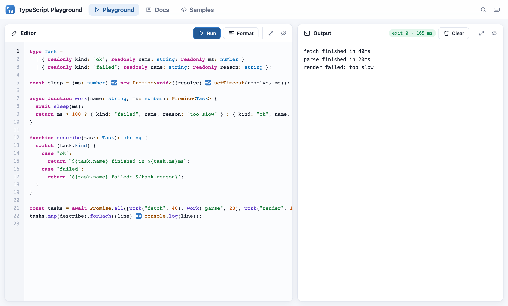

### Auto-complete
Typing `Promise.al` suggests `all` and `allSettled`, read from the live runtime. Tab or Enter accepts it.

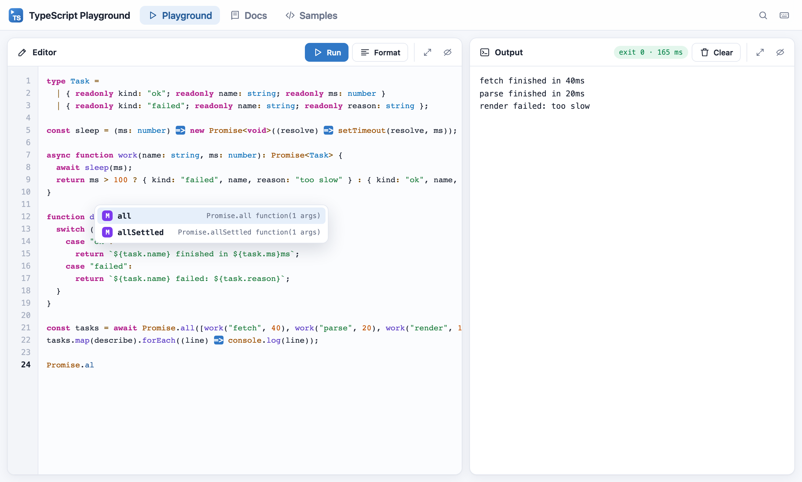

### Docs
The Promise Combinators article, with a table and highlighted code that has Copy and "Run in Playground" buttons.

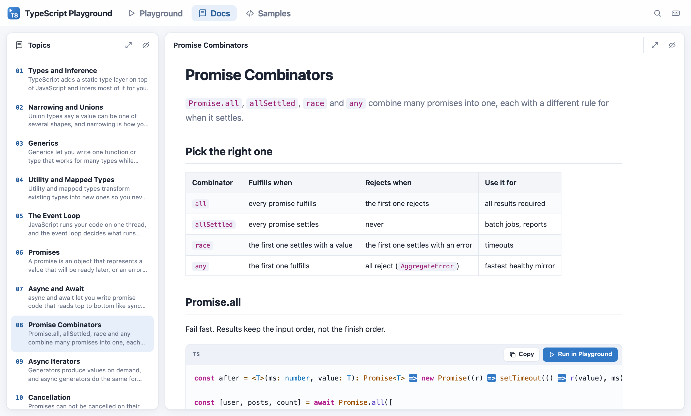

### Docs deep dive
The Event Loop article: the call stack, microtasks and macrotasks.

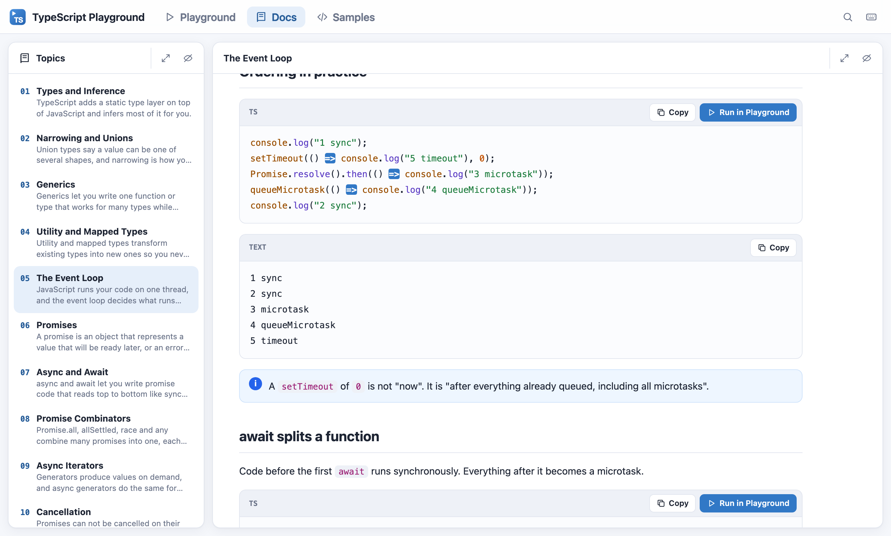

### Samples
The sample list with a read-only, highlighted preview. Open loads the sample into the editor, and Run also runs it.

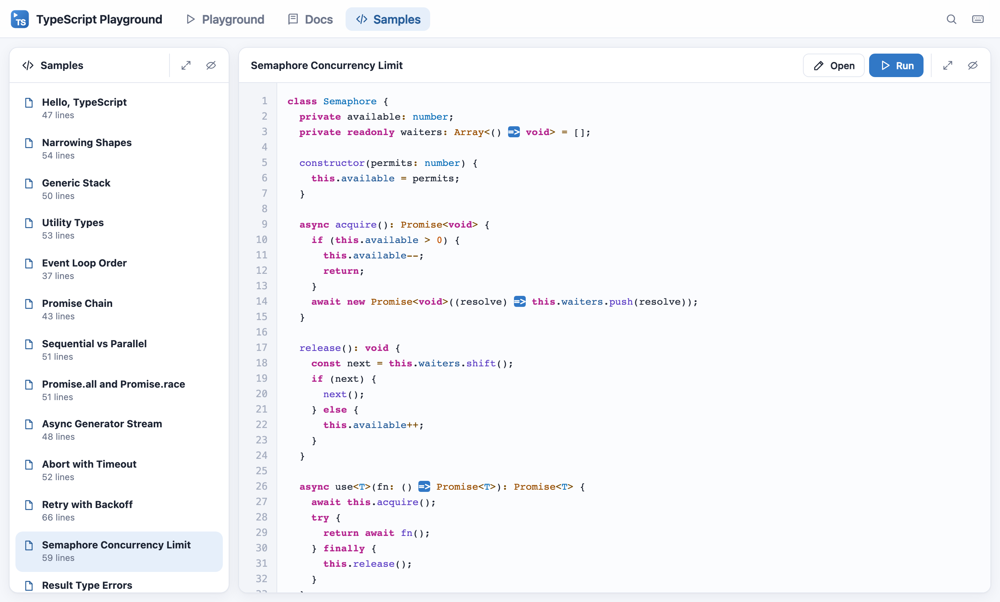

### Search (⌘ K)
One search over tabs, docs, samples and actions, with an icon on every entry.

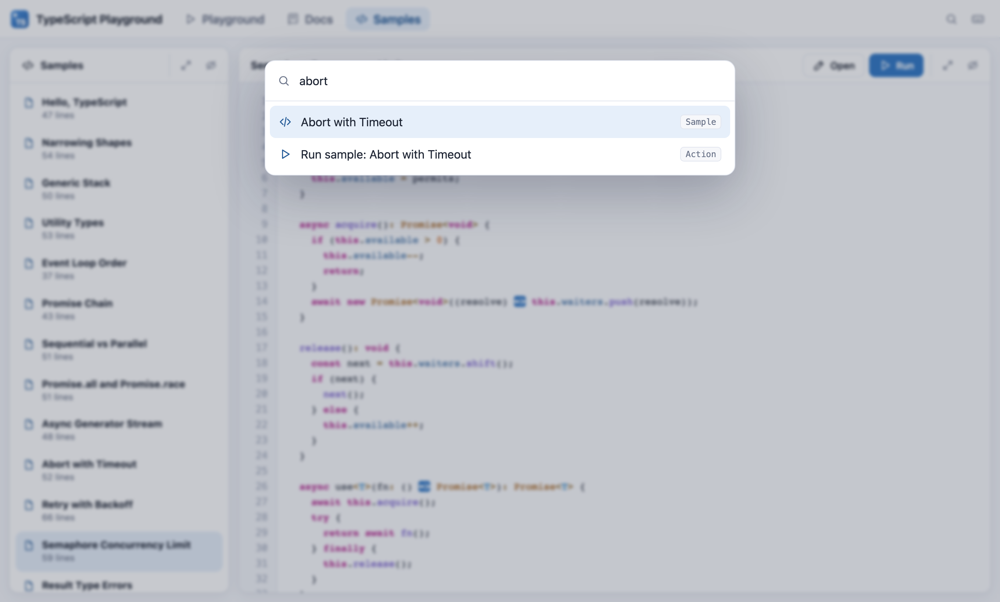

### Shortcuts (⌘ /)
Shortcuts grouped by area, each group in its own color, with a filter box and a match count.

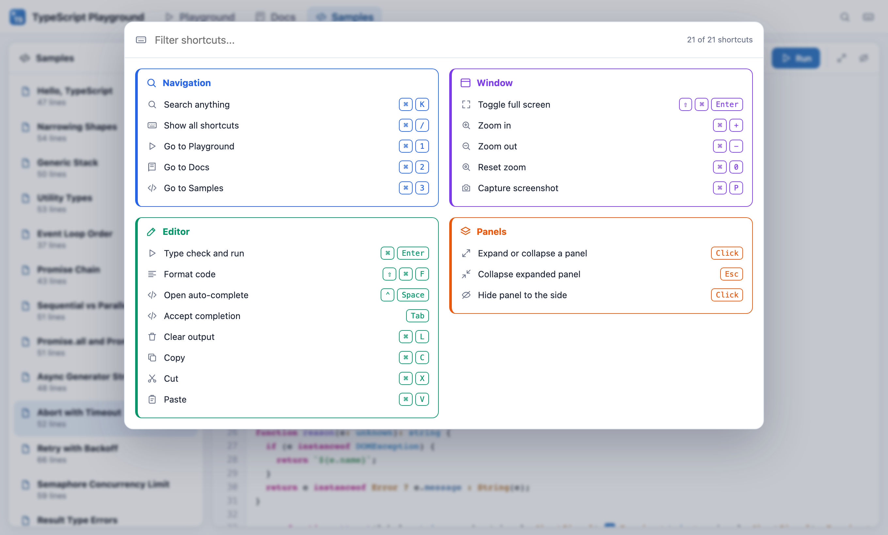

### Hidden panel
The Output panel hidden to a thin tab on the right edge. The editor takes the freed space, and a click on the tab restores the panel.

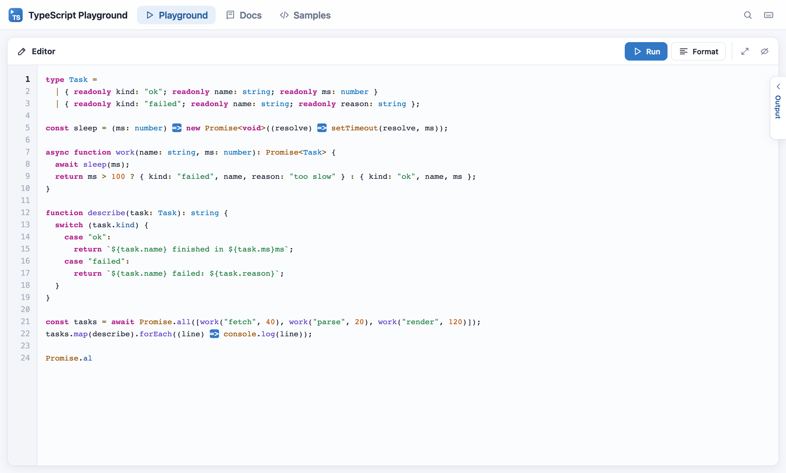

### Expanded panel
The editor expanded to almost full screen. Esc collapses it.

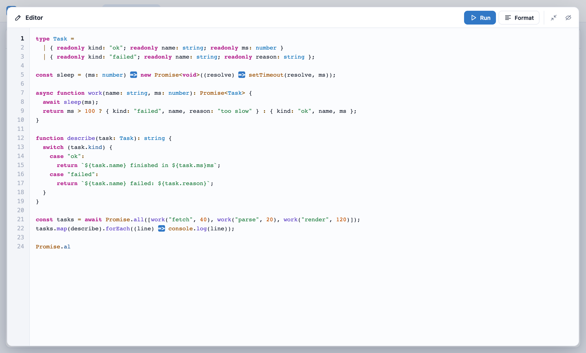

### Type errors
Assigning to a `readonly` property and a string to a `number`. Both lines turn red in the gutter, the output shows the `tsc` messages, and the program never runs.

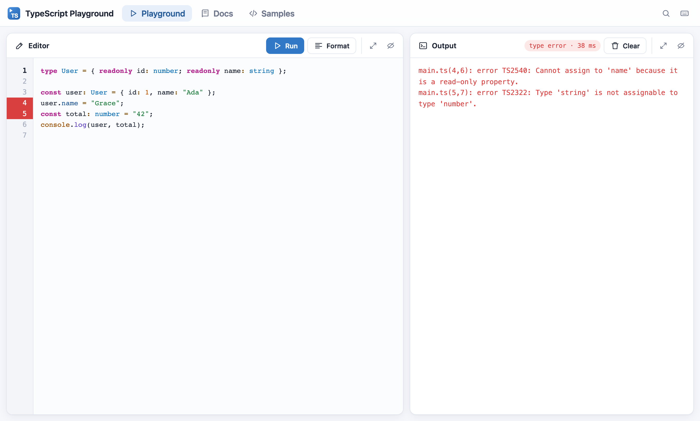

### Mobile
The same UI on a phone-sized screen: panels stack, and tabs become 44px touch targets.

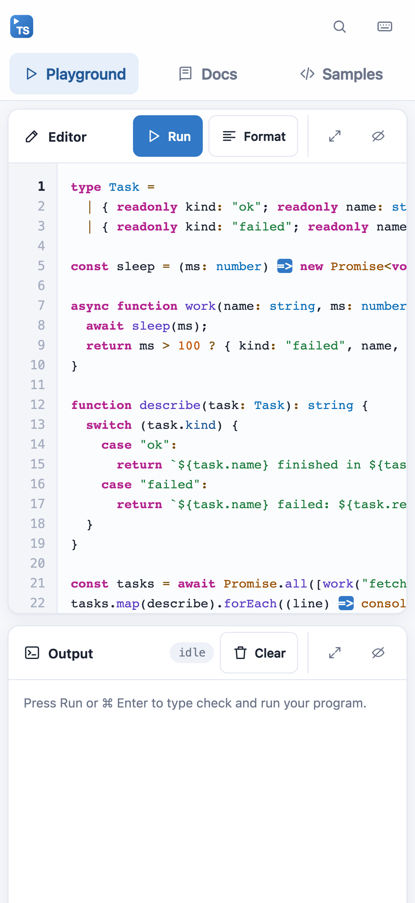
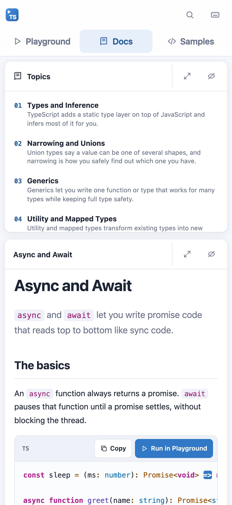

## Scripts

All scripts live in `scripts/` and run from any directory of the repository.

| Script | What it does |
|---|---|
| `./scripts/setup.sh` | Installs the server, web and Electron dependencies and builds the UI |
| `./scripts/start-all.sh` | Starts the server and prints the full link |
| `./scripts/status.sh` | Shows the server port as UP or DOWN |
| `./scripts/test-all.sh` | Runs the type checks and the server, web and Electron tests |
| `./scripts/ui.sh` | Opens the UI in the browser |
| `./scripts/stop-all.sh` | Stops the server |
| `./scripts/install.sh` | Installs exactly one copy of the macOS app |
| `./scripts/uninstall.sh` | Quits and removes the macOS app |

Ports are declared in `scripts/ports.env` (API on 8087).

```bash
./scripts/setup.sh
./scripts/start-all.sh
./scripts/status.sh
./scripts/ui.sh
./scripts/stop-all.sh
```
