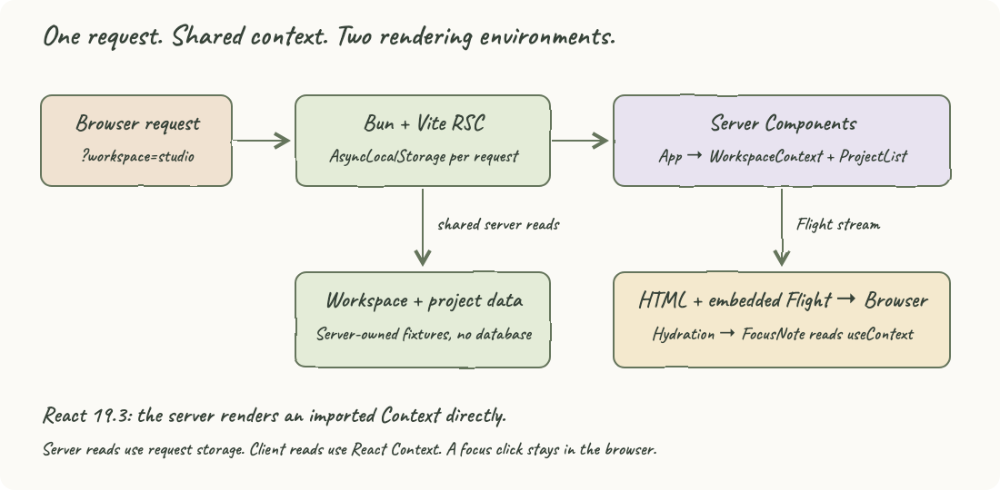
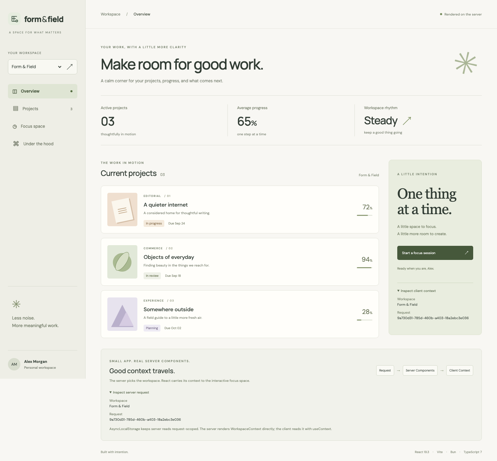
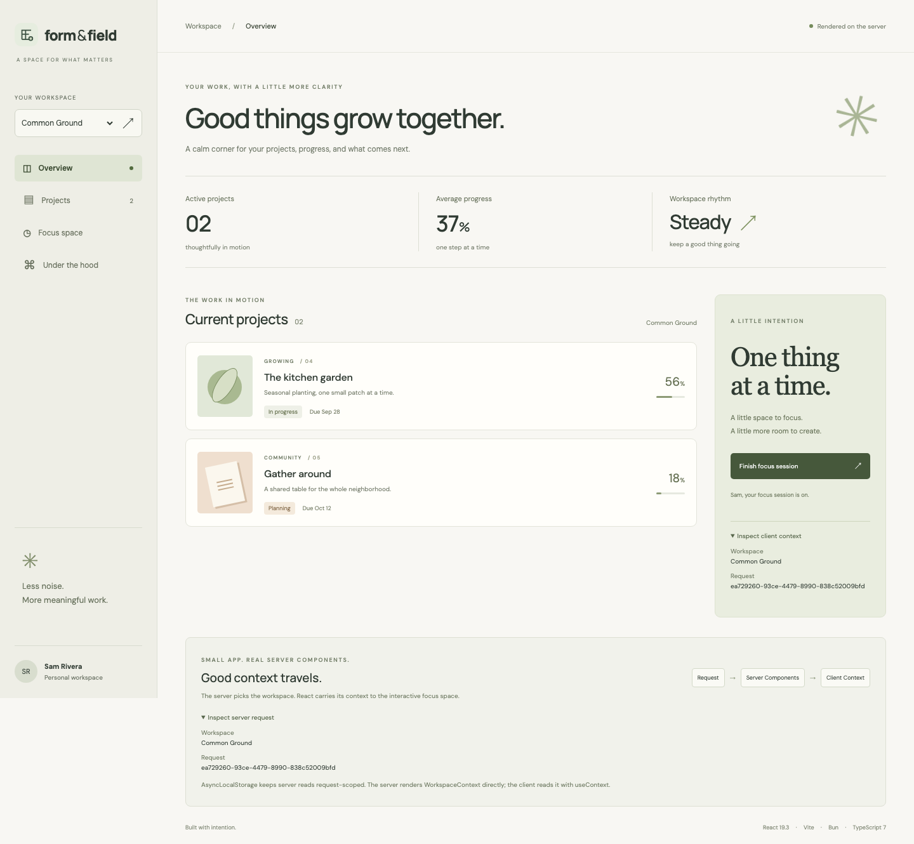
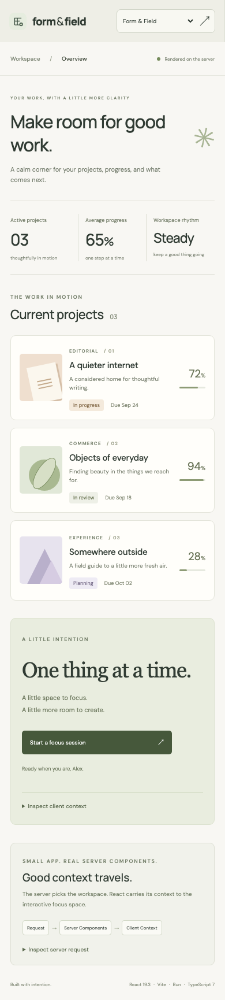

<p align="center"></p>

# Form & Field

A small, light-themed workspace app using React 19.3 Server Components, Vite, Bun, and TypeScript 7 native preview. Switch between two workspaces to see server-rendered projects and server-supplied React Context update together.

## How it Works?

1. A GET request selects a workspace through `?workspace=studio` or `?workspace=garden`.
2. Bun runs Vite's RSC environment with React's server conditions.
3. `AsyncLocalStorage` provides an isolated workspace and request ID to server code.
4. `App` and `ProjectList` read that request context without passing it through props.
5. `App` renders `<WorkspaceContext value={context}>` directly, a React 19.3 capability.
6. The Context is created in a `'use client'` module and consumed by `FocusNote` with `useContext`.
7. The RSC stream is decoded into HTML and embedded into that same response for hydration.
8. The focus button changes client state; switching workspace submits a fresh server request.

## Architecture



The [editable SVG](docs/architecture.svg) uses a wobble filter, Caveat handwriting, and pastel boxes. The solid arrows follow the request, server data reads, Flight serialization, and browser hydration. The pastel boxes separate request storage, server rendering, and client consumption.

| Location | Responsibility |
|---|---|
| `src/framework/entry.rsc.tsx` | HTTP routing, request scope, Flight rendering |
| `src/framework/entry.ssr.tsx` | HTML rendering and embedding the same Flight stream |
| `src/framework/entry.browser.tsx` | Browser hydration and server HMR refresh |
| `src/server/context.ts` | Workspace selection and async request isolation |
| `src/server/data.ts` | Server-only project fixtures selected by request context |
| `src/server/App.tsx` | Page layout and direct Context rendering |
| `src/server/ProjectList.tsx` | Async Server Component reading projects |
| `src/client/workspace-context.ts` | React Context definition and consumer hook |
| `src/client/FocusNote.tsx` | Interactive focus state and context inspection |

## Features

- Two workspaces with distinct owners and projects make request isolation visible.
- Inspectors expose matching server and client request IDs to verify context transfer.
- A focus session toggle exercises hydration and client state without a server round trip.
- Server-rendered content and workspace navigation work with JavaScript disabled.
- Responsive light styling supports desktop and mobile layouts.

## Stack

- **React / React DOM 19.3.0** — Server Components and direct Context rendering from the server.
- **react-server-dom-webpack 19.3.0** — Matching Flight runtime selected by Vite's RSC plugin; the app builds with Vite.
- **Vite 8.2.2 + @vitejs/plugin-rsc 0.5.34** — Separate RSC, SSR, and browser builds.
- **Bun 1.4.0** — Dependency installation, JavaScript runtime, and unit tests.
- **TypeScript 7.0.0-dev.20260707.2** — Native `tsgo` compiler preview for strict type checking.
- **rsc-html-stream 0.0.7** — Embeds the original Flight stream so hydration uses the same request data.
- **Playwright 1.63.0** — Browser verification and screenshots, invoked through `npx playwright`.
- **Plain CSS** — Responsive styling without a component library; Google Fonts supplies DM Sans and Manrope with local fallbacks.

Versions are pinned in `package.json` and `bun.lock`. TypeScript 7 is a preview; the low-level Vite RSC integration is experimental.

## Contracts/APIs

| Method and path | Response |
|---|---|
| `GET /` | Server-rendered studio HTML with embedded hydration payload |
| `GET /?workspace=garden` | Garden HTML; `studio` selects the default workspace |
| `GET /?workspace=garden&_rsc=1` | Flight stream with `text/x-component` content type |
| `GET /health` | JSON `{ "status": "ok" }` |
| Unknown paths | HTTP 404 |
| Non-GET requests to `/` | HTTP 405 and `Allow: GET` |

Unknown workspace values fall back to `studio`. Workspace responses use `Cache-Control: no-store`. This local POC has no authentication, persistence, database, or mutation API; the URL selector is not an authorization boundary.

## Data structures and design decisions

`Workspace` contains its ID, name, owner, initials, and heading. `RequestContext` combines that workspace with a fresh UUID. `Project` holds presentation data, status, and progress. Project fixtures remain in a server-only module.

React Context is created in the client environment. React 19.3 allows the server to render that imported Context directly; it does not enable `useContext` or `createContext` inside Server Components. `AsyncLocalStorage` supplies server-side request context separately. The serializable public values cross the Flight boundary, so secrets must never be added to that Context.

The initial Flight stream is split for SSR and browser hydration, avoiding a second request and mismatched request IDs. Workspace switching uses a native GET form, keeping routing small and supporting browsers without JavaScript. Focus state resets on navigation and is not persisted. Dates and projects are fixed fixtures.

## Run and test

Requires Bun 1.4.0 and Node.js/npm for `npx playwright`.

```bash
./scripts/setup.sh
./scripts/start-all.sh
./scripts/ui.sh
```

Open [the workspace](http://127.0.0.1:5178). For foreground development, use `bun run dev`.

```bash
./scripts/test-all.sh
./scripts/stop-all.sh
bun run start
```

`test-all.sh` runs strict type checking, all three production builds, Bun context tests, and Playwright browser tests. Playwright uses an already-running local app when available; otherwise it starts the built app with Vite preview. `bun run start` serves the production build on the same port, so stop the development process first.

The unit tests check unknown workspace handling, fail-fast context access, and 30 overlapping async requests. Browser tests verify HTML and Flight responses, HTTP error contracts, Context transfer, focus interaction, workspace isolation, mobile width, browser errors, and navigation without JavaScript.

## Verification

Validated with `./scripts/test-all.sh` on September 9, 2026:

```text
TypeScript check: passed
Vite RSC, browser, and SSR builds: passed
Bun tests: 3 pass, 0 fail, 64 assertions
Playwright: 3 passed
```

Browser checks also passed against both development and production. Start/stop idempotency and script execution from a nested directory were verified.

## Printscreens

### Studio overview



Three server-rendered projects, a client focus panel, and matching server/client request IDs. The sidebar links scroll to sections on this single page.

### Garden workspace



Switching workspace replaces the projects and owner. The active focus message reads Sam's name through the server-supplied React Context.

### Mobile



The sidebar becomes a compact header and the project list and focus panel stack vertically.

## References

- [React 19.3 release notes](https://react.dev/blog/2026/09/09/react-19-3) — Direct Context rendering from Server Components.
- [React Server Components](https://react.dev/reference/rsc/server-components) — Server and client execution boundaries.
- [Vite React RSC plugin](https://github.com/vitejs/vite-plugin-react/tree/main/packages/plugin-rsc) — Environment entries, Flight APIs, and matching React runtimes.
- [TypeScript native preview](https://github.com/microsoft/typescript-go) — Native TypeScript compiler development.

## Scripts

All scripts live in `scripts/` and run from any directory of the repository.

| Script | What it does |
|---|---|
| `./scripts/setup.sh` | Installs locked dependencies and Chromium |
| `./scripts/start-all.sh` | Starts the app and waits for its health endpoint |
| `./scripts/status.sh` | Shows the app port as UP or DOWN and its listener PID |
| `./scripts/test-all.sh` | Runs the build and both test suites |
| `./scripts/ui.sh` | Opens the UI in the default browser |
| `./scripts/stop-all.sh` | Stops the app process recorded by the start script |

Port **5178** is declared once in `scripts/ports.env`, which is also read by Vite and Playwright. Runtime PID and log files live in ignored `.run/`. No SQL console is needed because this app has no database.
