<p align="center"></p>

# TanStack 1.x Fun

A light-themed bookstore app that shows the best TanStack Router 1.x and TanStack Form 1.x features in 10 tabs, together with TanStack Query and TanStack Table v9. Each tab focuses on one feature: type-safe search params, loaders, cache integration, a code-split headless table, typed forms, preloading on hover, navigation blocking, error boundaries, deferred data and route guards.

## How it Works?

1. `src/router.tsx` builds a code-based route tree and registers it, so every `Link`, `navigate` and hook is fully typed.
2. The router context injects `queryClient`, `api` and `auth` into every route, with no globals in the components.
3. On navigation the router runs `validateSearch`, then `beforeLoad` (guards), then `loader`, then renders the component.
4. Loaders either fetch directly (`api.getBook`), or warm the Query cache with `ensureQueryData`, so components can use `useSuspenseQuery` without spinners.
5. A loader can return an unawaited promise, and the component streams it with `<Await>`.
6. Thrown `Error`s render the route `errorComponent`. A thrown `notFound()` renders its `notFoundComponent`. A thrown `redirect()` sends you to the login page.
7. The Table tab is loaded on demand in its own chunk through `lazyRouteComponent`.
8. A fake in-memory API (`src/data/api.ts`) adds latency, so pending states and preloading are visible.

## Architecture

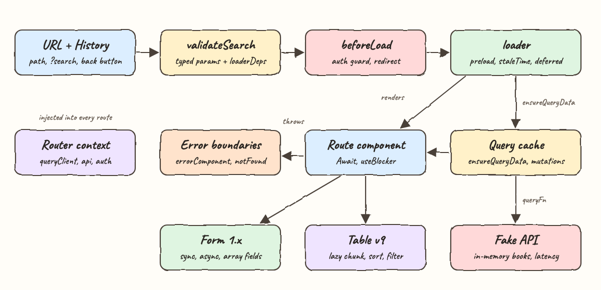

The [editable SVG](docs/architecture.svg) shows the navigation pipeline on the top row and what the rendered route uses below it.

| Location | Responsibility |
|---|---|
| `src/main.tsx` | Mounts `QueryClientProvider` and `RouterProvider` |
| `src/router.tsx` | Route tree, router context, defaults, type registration |
| `src/routes/root.tsx` | Root layout, 10 tabs, global pending bar, not found page |
| `src/routes/search.tsx` | Tab 1: search params as state |
| `src/routes/loaders.tsx` | Tab 2: loaders, typed path params, nested routes |
| `src/routes/query.tsx` | Tab 3: loader + Query cache + optimistic mutation |
| `src/routes/table.tsx`, `table-view.tsx` | Tab 4: lazy route + Table v9 |
| `src/routes/form.tsx` | Tab 5: Form 1.x with sync, async and array fields |
| `src/routes/preload.tsx` | Tab 6: preload on intent |
| `src/routes/blocker.tsx` | Tab 7: `useBlocker` with a custom confirm |
| `src/routes/errors.tsx` | Tab 8: errorComponent, notFound, loaderDeps |
| `src/routes/deferred.tsx` | Tab 9: deferred promise with `<Await>` |
| `src/routes/guard.tsx` | Tab 10: `beforeLoad` guard, redirect and login |
| `src/logic/*.ts` | Pure logic: search parsing and filtering, validators, auth, safe redirects |
| `src/data/*.ts` | Seed books, fake API, query options |

## Features

1. **Search Params as State**: the URL holds the filter state. It is shareable, works with the back button, and defaults are stripped by `stripSearchParams`.
2. **Loaders + Typed Path Params**: `$bookId` is parsed to a `number`. With a 10s `staleTime`, revisits reuse cached data.
3. **Query Integration**: `ensureQueryData` in the loader means no loading flash. The optimistic toggle rolls back when the server fails.
4. **Table v9, Code-Split**: tree-shakable features (sorting, global filter, pagination) in a lazily loaded chunk.
5. **Form 1.x**: field names and values are typed. Validation is sync, async with debounce (ISBN taken?), plus form-level array validation.
6. **Preload on Intent**: hovering a link starts its 1.5s loader, so the page opens with no wait when clicked.
7. **Navigation Blocking**: a dirty draft stops in-app navigation and page reloads, with a custom confirm panel.
8. **Error Boundaries**: per-route `errorComponent` and `notFoundComponent` keep the rest of the app usable. "Retry" calls `router.invalidate()`.
9. **Deferred Data**: fast stats render right away while slow reviews stream in.
10. **Route Guards**: `beforeLoad` redirects anonymous users to login and returns `user` into the typed route context.

## Stack

- **TanStack Router 1.170.46**: type-safe routing, loaders, search params, preloading, blocking.
- **TanStack Form 1.33.5**: headless, fully typed form state and validation.
- **TanStack Query 5.105.0**: server-state cache. The latest major, since Query has no 1.x line.
- **TanStack Table 9.3.1**: headless datagrid. The latest major, since Table has no 1.x line.
- **React / React DOM 19.3.1**: UI runtime.
- **Vite 8.3.5 + @vitejs/plugin-react 6.1.2**: dev server, build and code splitting.
- **Bun 1.4.4**: install, run and unit tests. Bun 2.x is not released yet.
- **TypeScript 7 (`@typescript/native-preview` 7.0.0-dev.20260707.2)**: native `tsgo` strict type checking.
- **Playwright 1.63.0**: e2e tests for every tab, which also capture the screenshots.
- **Plain CSS**: no UI library.

## Contracts/APIs

There is no HTTP backend. The UI talks to an in-memory fake API (`src/data/api.ts`) with simulated latency:

| Function | Result |
|---|---|
| `listBooks()` | All books |
| `getBook(id)` | One book or `undefined` (the route throws `notFound()`) |
| `toggleFavorite(id)` | Updated book. Fails once when `setFailNextWrite(true)` is set |
| `isIsbnTaken(isbn)` | `true` when the ISBN exists |
| `addBook(input)` | New book with the next id. Rejects duplicate ISBNs |
| `stats()` | Totals and average rating |
| `reviews(delayMs)` | Reviews after a delay, used as a deferred promise |

Routes and search params:

| Route | Search params |
|---|---|
| `/search` | `q`, `genre` (`all`, `scifi`, `fantasy`, `mystery`, `tech`), `sort` (`title`, `year`, `rating`), `dir` (`asc`, `desc`) |
| `/loaders/$bookId` | `bookId` is a number |
| `/preload/$bookId` | `bookId` is a number |
| `/errors` | `mode` (`ok`, `boom`, `missing`) |
| `/login` | `redirect`, an in-app path only |

## Design Decisions

- **Code-based routes** instead of file-based generation: no generator or plugin needed, and still fully typed through `Register`.
- **Dependencies through the router context**: routes receive `api` and `auth` from the context, so tests can create isolated instances with `createApi(0)` and `createAuth()`.
- **`SearchSchemaInput`** marks the validator input as partial, so links can omit params while the component still reads a complete, typed object.
- **Invalid URLs never crash**: `parseCatalogSearch` falls back to defaults for unknown values.
- **`safeRedirect`** blocks open redirects (`//host`, absolute URLs) after login.
- **Form-level tag validation**: array subfield edits don't trigger the array field's own validator, so the rule runs at the form level and reports on the `tags` field.

## How to run

```bash
./scripts/setup.sh
./scripts/start-all.sh
./scripts/test-all.sh
./scripts/stop-all.sh
```

`test-all.sh` runs the TS 7 typecheck, 20 unit tests (`bun test tests/unit`) and 10 Playwright e2e tests (`tests/e2e`). The e2e run regenerates `printscreens/`.

## Printscreens

### 1. Search Params
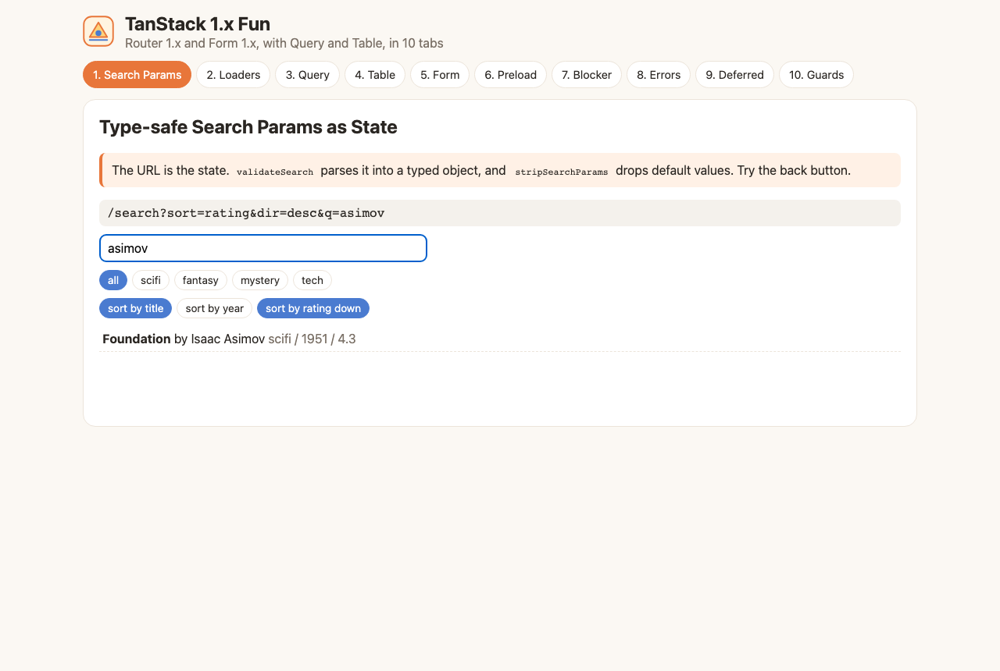
Typing "asimov" updates `?q=` in the URL shown at the top, and only Foundation remains. Default values are not written to the URL.

### 2. Loaders
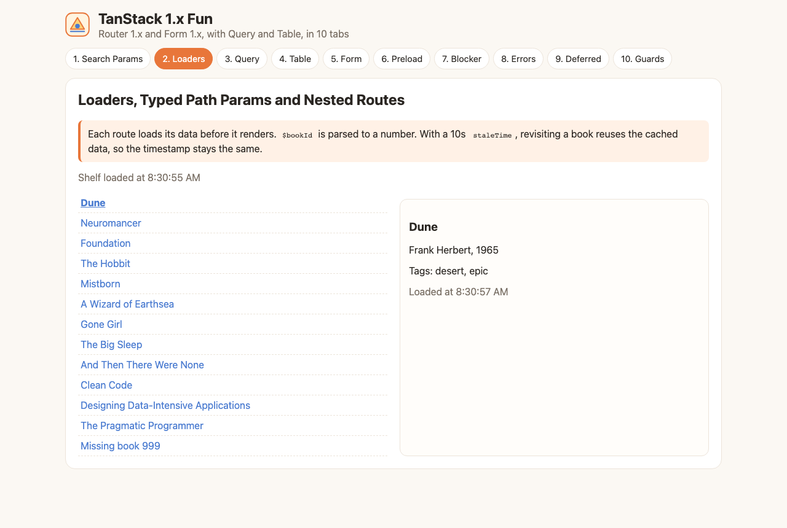
The nested `/loaders/1` route loaded Dune in the card next to the list. The "Missing book 999" link throws `notFound()` inside the card only.

### 3. Query
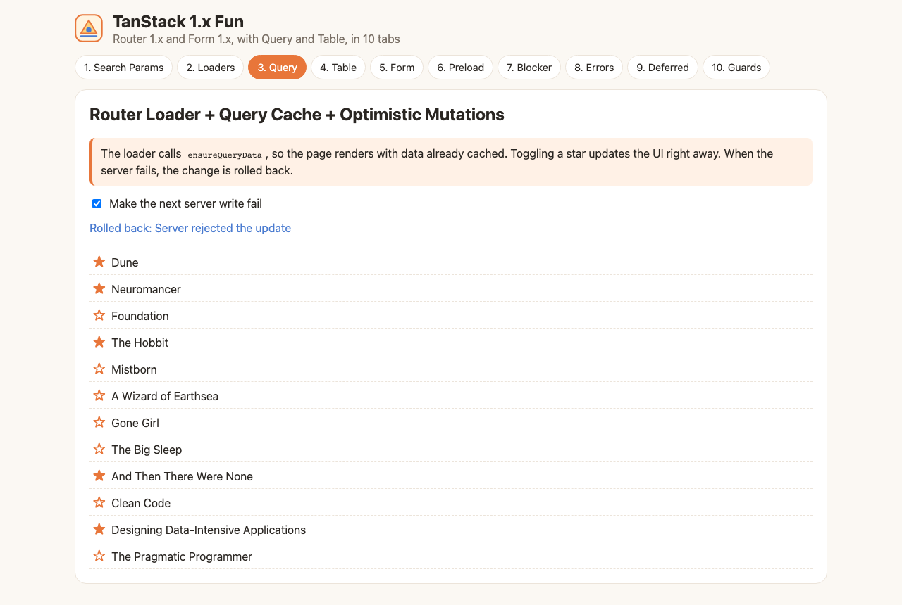
"Make the next server write fail" is on. The star changed right away, the server rejected the write, and the cache rolled back.

### 4. Table
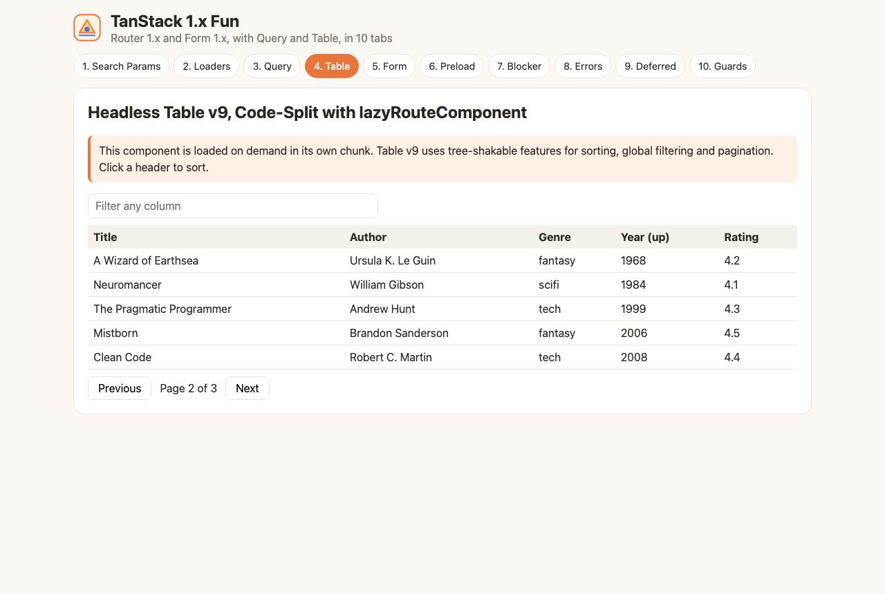
Table v9 sorted by year, on page 2 of 3. The component came from a lazy chunk.

### 5. Form
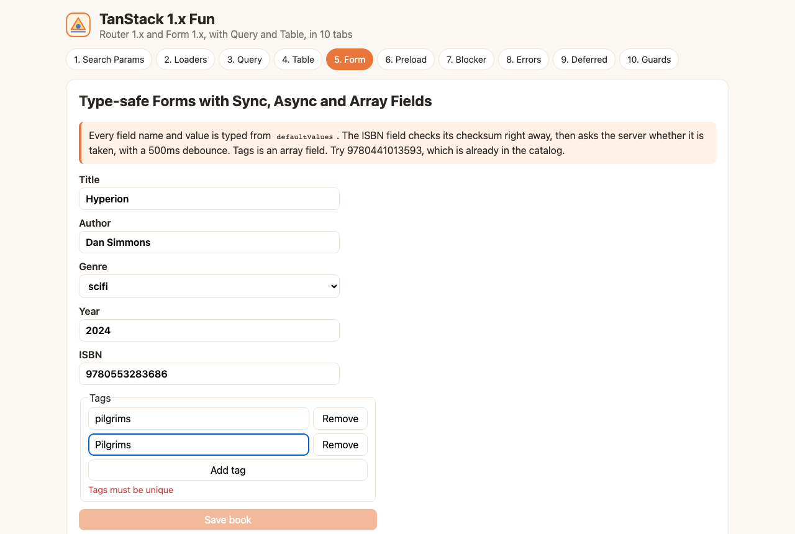
The ISBN passed the checksum and the async "taken" check. The duplicate tag "Pilgrims" is rejected, so Save stays disabled.

### 6. Preload
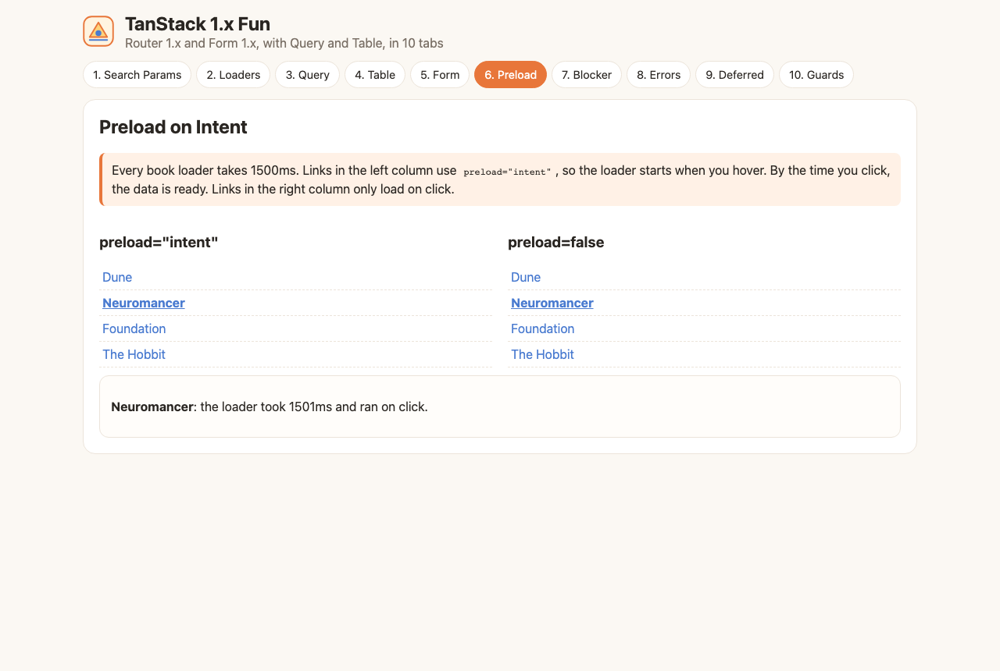
"Neuromancer" was clicked in the `preload=false` column, so the loader ran on click and took about 1.5s. The hovered `preload="intent"` link opens with no wait.

### 7. Blocker
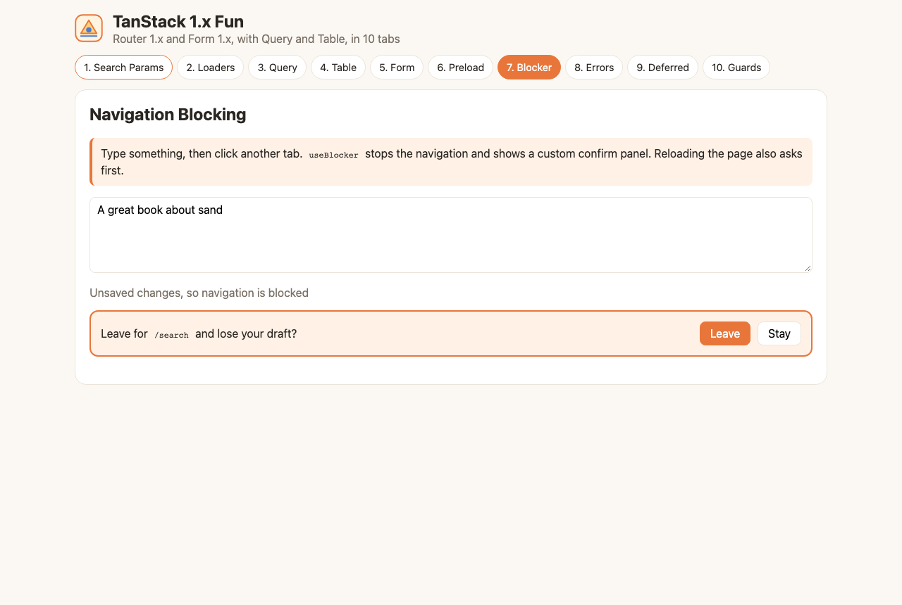
A draft exists, so navigating to Search Params was blocked and the custom confirm panel asks to Leave or Stay.

### 8. Errors
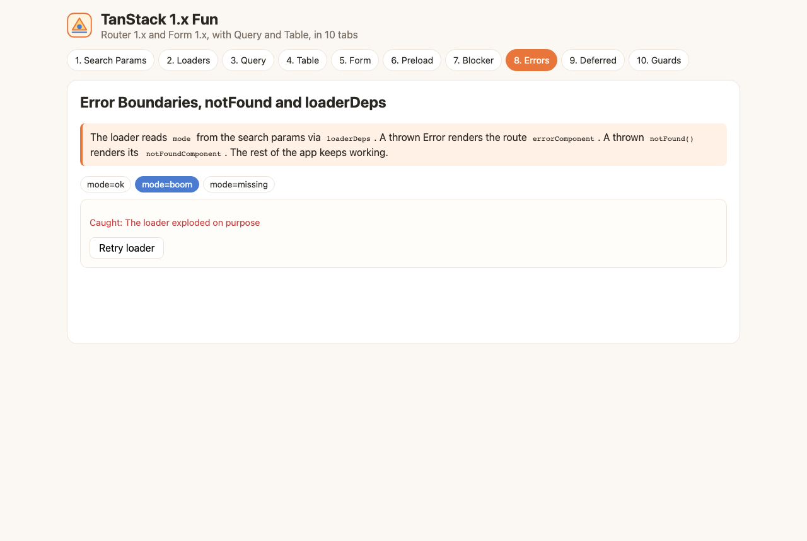
`mode=boom` makes the loader throw. The route `errorComponent` shows the error with a Retry button while the tabs keep working.

### 9. Deferred
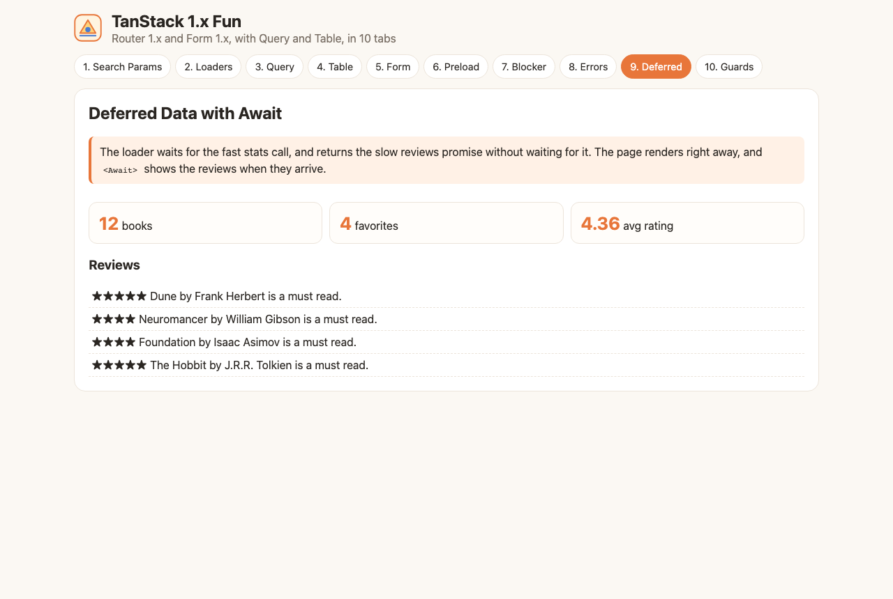
Stats rendered first. The reviews promise resolved later and `<Await>` replaced the fallback.

### 10. Guards
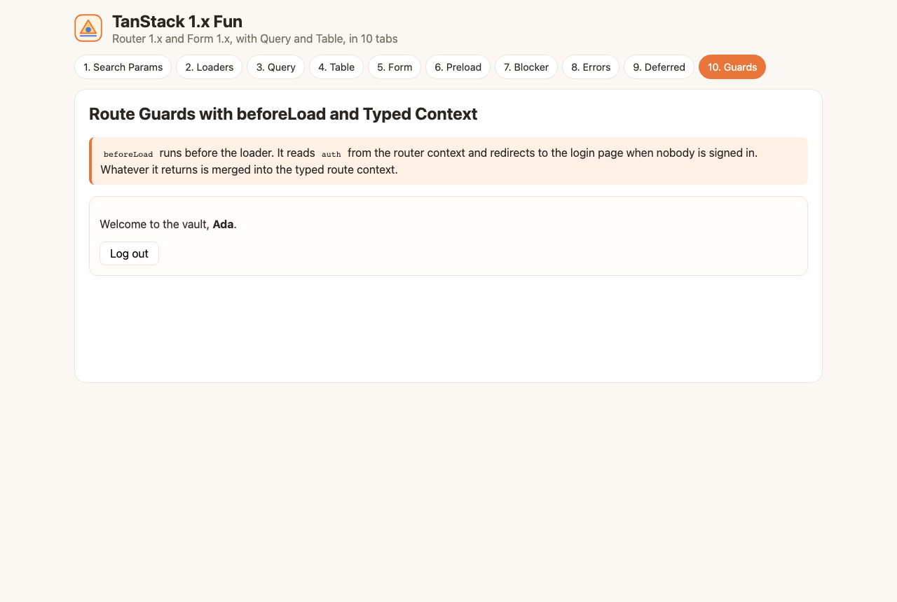
`/vault` redirected to `/login?redirect=/vault`. After logging in as Ada, the user came back to the vault, with `user` coming from `beforeLoad`.

## Scripts

All scripts live in `scripts/` and run from any directory of the repository.

| Script | What it does |
|---|---|
| `./scripts/setup.sh` | Installs dependencies and the Playwright browser |
| `./scripts/start-all.sh` | Starts the Vite dev server and prints its full link |
| `./scripts/status.sh` | Shows the frontend port as UP or DOWN |
| `./scripts/test-all.sh` | Runs typecheck, unit tests and e2e tests |
| `./scripts/ui.sh` | Opens the UI in the browser |
| `./scripts/stop-all.sh` | Stops the dev server |

Ports are declared in `scripts/ports.env` (frontend on `5191`).

```bash
./scripts/setup.sh
./scripts/start-all.sh
./scripts/status.sh
./scripts/ui.sh
./scripts/stop-all.sh
```
